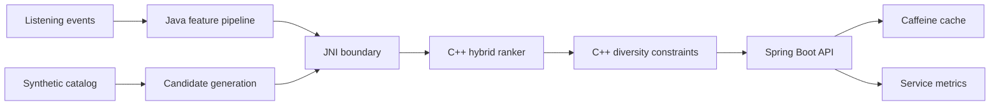

# Polyglot Music ML Platform

Polyglot Music ML Platform demonstrates a scalable personalization architecture using Java for ML pipeline orchestration and customer-facing APIs, with C++ for low-latency ranking and diversity optimization.

The repository contains more than 1,000 lines of Java and C++ source code. Documentation and configuration files are not included in that count.

## Architecture



## Java service layer

- Spring Boot recommendation and event APIs
- Virtual-thread request execution for concurrent personalization
- Multi-source candidate generation from preferences, history, popularity and exploration
- Feature engineering for affinity, genre, energy, language, freshness, completion and quality
- Deterministic A/B experiment assignment
- Caffeine response caching and request metrics
- Event minimization, hashed identifiers, retention and deletion
- Temporal evaluation and bootstrap experiment comparison

## C++ inference layer

- C++20 contiguous feature matrices
- Normalization and stable sigmoid scoring
- Weighted hybrid relevance model
- Greedy diversity and exploration reranking
- Artist and genre frequency constraints
- JNI conversion layer for Java arrays and native results
- Java fallback ranker when the native library is unavailable

## API endpoints

| Endpoint | Purpose |
|---|---|
| `POST /v1/recommendations` | Produce personalized and diversified rankings |
| `POST /v1/events` | Ingest one privacy-minimized signal |
| `POST /v1/events/batch` | Ingest a bounded event batch |
| `DELETE /v1/listeners/{id}` | Delete retained listener history |
| `GET /v1/health` | Report catalog and native ranker status |
| `GET /v1/metrics` | Report requests, failures and cache usage |

## Build outline

```bash
cmake -S native -B native/build
cmake --build native/build --config Release
./gradlew bootJar
java -Djava.library.path=native/build -jar build/libs/polyglot-music-ml-platform-0.1.0.jar
```

The Java service automatically uses its object-oriented fallback ranker when the native library is not present.

## ML lifecycle

The design separates signals, features, retrieval, ranking and policy reranking so researchers can change an algorithm without rewriting the serving API. Stable experiment bucketing supports controlled launches. Offline utilities use temporal holdouts, ranking metrics and bootstrap confidence intervals before a model reaches the online path.

## Scale and reliability

Virtual threads isolate concurrent requests while Caffeine bounds and expires cached results. Regional request headers model global routing. The native ranker uses contiguous memory and avoids allocations inside feature scoring. Repository interfaces allow in-memory data components to be replaced with distributed stores and event streams.

## Privacy

The service uses anonymous listener identifiers, HMAC hashing, bounded event context, 30-day retention and deletion endpoints. All tracks and artists in the demonstration catalog are synthetic.

## Scope

This is an independently designed portfolio project. It does not reproduce Apple Music data, algorithms, services or internal architecture.

## License

MIT
